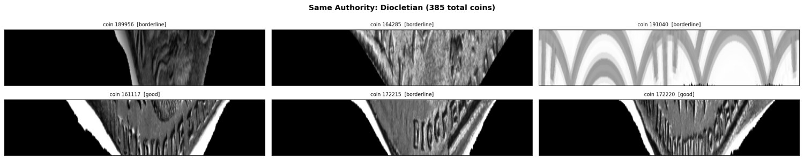
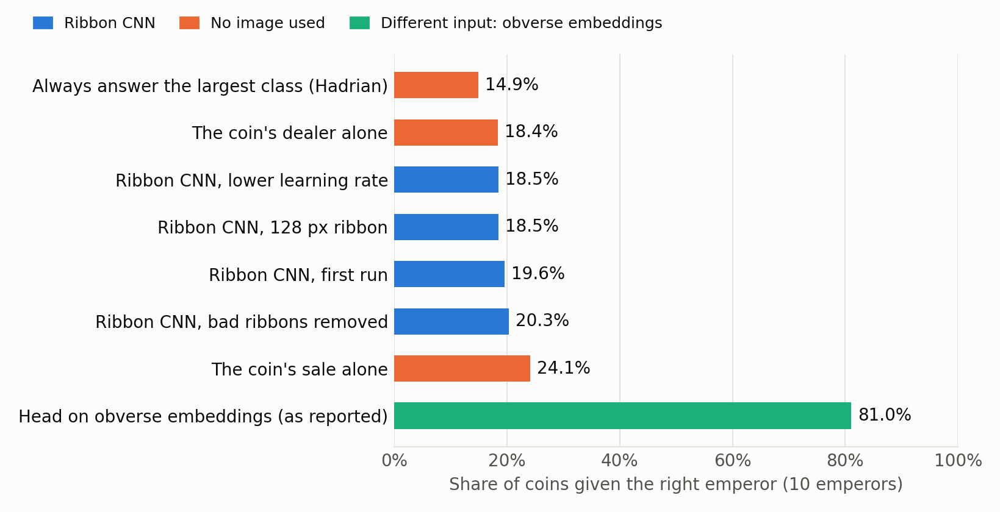
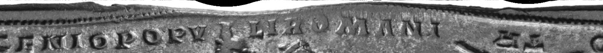
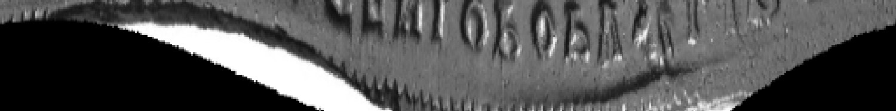
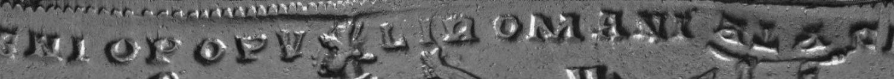
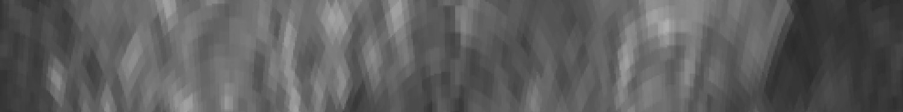
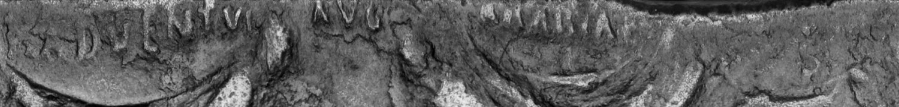

# Review of the legend-ribbon ("polar unwrap") experiment of April 2026

Reviewed 2026-11-23. Scope: the code, the stored outputs and the write-up of the experiment in `legend_cnn/` and in
`specs/legend_cnn_and_embedding_heads_results.md`, Part 1. Nothing was retrained. Every number below is recomputed from the
stored files by `review_numbers.py` in this folder.

## Summary

The April write-up concluded that a strip of legend cut from the coin and straightened (a "ribbon") cannot tell emperors
apart, and called the approach a dead end. **The stored outputs do not support that conclusion.** The experiment did not
test the idea, for three reasons. Each one alone is enough.

1. **It used the wrong side of the coin.** 5,715 of the 6,232 images are files named as the reverse, 517 are numbered
   crops of unknown side, and none is named as the obverse. The emperor's name is on the obverse.
2. **The strip was cut from the wrong place.** The coin's centre and radius were measured on one image file and applied
   to a different file of a different size. For 48.7% of the ribbons the radius used is larger than the image allows.
   Another 31.9% fell back to a fixed circle. Only 4.5% used a centre and radius that are even plausible.
3. **The score was no better than a guess that never looks at the coin.** The network scored 18.5% to 20.3%. Naming
   the most common emperor of the coin's dealer scores 18.4%. Doing the same by sale scores 24.1%.

So the question "does a straightened legend strip help" is not answered no. It is unanswered. On three coins a strip cut
correctly is readable by eye (Figure 4). That is an illustration, not a measurement.

One consequence reaches beyond this experiment. The legend-reading plans (`docs/ocr_poc_pc_prep.md`,
`docs/ocr_poc_runbook.md` in the pipeline repository) ban polar unwrapping as "a measured dead end" and cite this
result. The measurement behind that ban did not measure it.

## What the experiment was

- **Question:** can a small network tell ten Roman emperors apart from the look of the legend alone?
- **Coins:** 6,232 Roman Imperial coins of ten emperors, split 4,996 / 618 / 618 for training, validation and test.
- **Method:** find the coin's centre and radius, cut a ring at 68% to 92% of the radius, straighten it into a strip of
  64 by 512 pixels, and train a four-layer network on the strips.
- **Result as reported:** 18% to 20% right on validation in four runs, against "10% for chance".
- **Conclusion as reported:** the strip is the bottleneck; optimisation, data quality and resolution were ruled out; do not
  pursue it.

## Findings

### 1. The images are the reverse side

The coin list was built by taking, for each coin, the newest image row in the database
(`select_subset.py`, `MAX(id)`). For most coins that row is the reverse.

| Side, by file name | Coins |
|---|---|
| Named reverse | 5,715 |
| Numbered crop, side unknown | 517 |
| Named obverse | 0 |

The reverse legend usually names a deity, a virtue or a string of titles. The two Diocletian coins fetched for this
review both read GENIO POPVLI ROMANI, a legend struck in the same words for Diocletian, Maximian and their colleagues.
No reader, human or machine, can name the emperor from it. The write-up never states which side was used, and its
comparison in Part 2 used obverse image embeddings on the same coins, so the two parts were not compared like for like.

The file name is a stand-in for the side and is not always right: one stored ribbon from a file named reverse shows
"DIOCLE", an obverse legend.

### 2. The centre and radius were applied to the wrong image

The pixels came from the 512 by 512 crop. The centre and radius came from the coin's mask file, which is a different
crop at a different size. The numbers were used without conversion.

- Of 237 mask files sampled at random, none is 512 by 512. Widths run from 89 to 1,201 pixels (5th to 95th
  percentile), median 665. For 156 of them the two sides differ by more than 5%.
- The run's own statistics show the result. All 6,232 training ribbons:

| Geometry used | Ribbons | Share |
|---|---|---|
| Own centre, radius above 256 px (larger than a 512 px image allows) | 3,032 | 48.7% |
| Fixed fallback circle, centre (256, 256), radius 220 | 1,989 | 31.9% |
| Own centre, radius within 256 px, centre over 40 px from the image centre | 928 | 14.9% |
| Own centre, radius within 256 px, centre within 40 px | 283 | 4.5% |

Figure 1 shows one coin. The ring that was cut (red) sits to the right of the coin and runs off the image. One third of
all ribbons (2,086) are less than half filled; the rest is black. Figure 2 is a page of the stored ribbons as the April
reviewers saw them.

### 3. The network did no better than guesses that use no image

- "Chance" is not 10%. The classes are unequal, and always answering Hadrian scores 14.9%.
- Naming the most common emperor of the coin's dealer, with no image, scores 18.4%. By sale it scores 24.1%.
- The four runs differ from each other by less than the sampling error: on 618 coins one standard error is 1.6 points.
- The network barely fitted its own training data. The training loss moved from 2.27 to between 2.03 and 2.12. A model
  that only knows the class shares scores 2.27.
- No test-set result exists. The reported figures are validation figures at the best epoch.

What little the network learned is at the level of "which dealer photographed this". Nothing shows it used the legend.

### 4. The quality score could not see the fault

The sweep that chose the ring's settings scored each ribbon on how much of it was non-black and how much texture it
held. Nothing checked that the legend was in the ring.

- 1,774 of the 3,032 ribbons cut with an impossible radius were graded "good".
- A wider ring always scores higher on this measure, because it takes in more of the coin. The "promoted" setting won
  by 0.012 on a score from 0 to 1, on 300 coins.

### 5. "Resolution was ruled out" was not tested

The 128-pixel run resized the same 61 rows of samples to 128 pixels. It added no detail. The source image was 512
pixels wide in every run. The mask files hold the coin at a median width of 665 pixels and up to about 1,200.

### 6. What a correct strip looks like

For three coins fetched for this review, the strip was cut again from the mask file alone, so that the pixels, the
centre and the radius share one frame. This is an illustration on three coins.

**Coin 164261, as the experiment cut it:**

**Coin 164261, cut in one frame:**

**Coin 164314, as the experiment cut it:**

**Coin 164314, cut in one frame:**

**Coin 137496, as the experiment cut it (fallback circle):**

**Coin 137496, cut in one frame:**

## What the April notes saw but did not connect

The symptoms were recorded at the time. Each is what a mismatch between the two files predicts.

- Baseline review: the fallback rate was 45.7%, "all center_out_of_bounds".
- Baseline review: the best fallback ribbons "show clear, legible legend text — better than many `good` ribbons".
- Promotion note: 22 coins got worse when the coin's "actual" centre replaced the fallback; their centres were on
  average 183 pixels from the image centre.
- Results: "geometry artifacts (black wedges from polar unwrap) dominate over legend content".

A centre 183 pixels off in a 512-pixel image of a centred coin was read as an off-centre coin. It was a centre measured
on another file.

## Which April conclusions stand

| April conclusion | Verdict |
|---|---|
| The ribbon network reached 18% to 20% on validation | Stands as a number. It is at the level of a guess from the dealer |
| The strip is the bottleneck; "the unwrap destroys more letter structure than it preserves" | Not supported. The strips were cut in the wrong place from the wrong side |
| Optimisation, data quality and resolution are ruled out | Not supported. Resolution was not varied; the data fault was not found |
| Ribbon-only classification is a validated dead end | Not supported. Unmeasured |
| Part 2: heads on obverse embeddings reach 81% | Not reviewed here beyond its input. Nothing found against it |

## What a valid test needs

1. **One frame.** Cut the strip from the mask file alone (its own pixels and its own outline), or measure the centre
   on the image that is cut. The mask file is also the larger image.
2. **The side that holds the answer.** The obverse for the emperor; the reverse only for a question the reverse can
   answer.
3. **Guesses to beat, named before the run:** the largest class, the dealer, the sale. Split the coins by sale so that
   a dealer's photographic style cannot carry the score.
4. **A check that the legend is in the ring,** against a few hundred coins marked by hand, in place of a texture score.
5. **For legend reading,** the test that matters is a different one: a reader given the corrected strip against the
   same reader given the whole coin. The reading plans note that letters are about 10 pixels high on a whole coin at
   384 pixels.

The unwrap itself is cheap: the April run cut 6,232 strips in 129 seconds.

## Git

Added in this review (`trivalaya-vision`, not pushed):

- `legend_cnn/data/`: `confusion_subset.csv`, `splits_v1.json`, `eval_subset_v1.csv`, `eval_subset_test.csv`,
  `norm_ranges.json`. These define which coins were used and how they were split. They were ignored by a blanket
  `data/` rule and existed only on this machine.
- `legend_cnn/runs/run_20260410_002707_baseline/BASELINE_REVIEW.md`: the April baseline review, never committed.
- `legend_cnn/review_2026_11_23/`: this report (`REPORT.md`, and `legend_unwrap_review_2026-11-23.pdf` printed from it),
  its figures, the scripts that produce its numbers and figures, and `NOT_IN_GIT.md`.
- A dated notice at the top of Part 1 of the April write-up, pointing here.

Left out of git, listed in `NOT_IN_GIT.md` with sizes and checksums: the 6,232 ribbon arrays (818 MB), the run
galleries and previews (195 MB), the ribbon gallery images in `data/` (36 MB) and three model checkpoints (19 MB).
The ribbons can be rebuilt from the code and the coin list; they are also the faulty ones.

## How this review was done, and its limits

- Counts of sides, classes, baselines, training logs and geometry are over all 6,232 coins, from stored files.
- Mask sizes are from a random sample of 240 files, of which 237 could be read.
- The side of a coin is taken from its file name. It was checked by eye on two coins only.
- Three image pairs were fetched to reproduce the fault and to cut the corrected strips. The reproduction gave the
  run's stored centre and radius for coin 164261 exactly. For coin 164314 the centre differs (293 against the stored 335),
  so that mask file has probably been remade since April.
- The mask sizes are those of today's files. The centre, radius and fallback figures are April's own, from the run's
  stored statistics, and do not depend on today's files.
- The network was not retrained. This review shows the experiment was not valid; it does not show that a correct strip
  works.
